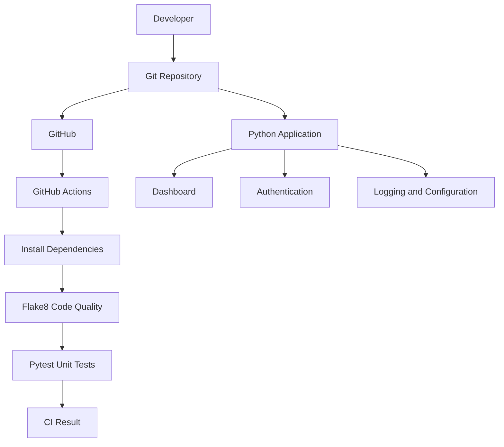

# DevOps Core Tooling

A Python-based project demonstrating core DevOps practices, Git collaboration, automated testing, and GitHub Actions CI.

## Table of Contents

- [Overview](#overview)
- [Architecture](#architecture)
- [Technology Stack](#technology-stack)
- [Prerequisites](#prerequisites)
- [Installation](#installation)
- [Usage](#usage)
- [Testing and Code Quality](#testing-and-code-quality)
- [CI Workflow](#ci-workflow)
- [Project Structure](#project-structure)
- [Security Notes](#security-notes)
- [Contributing](#contributing)
- [Code of Conduct](#code-of-conduct)
- [License](#license)

## Overview

DevOps Core Tooling is a sample Python project used to demonstrate practical software engineering and DevOps workflows.

The repository includes:
- A simple Python application.
- Dashboard and configuration modules.
- Authentication and logging modules.
- Automated tests using Pytest.
- Code quality checks using Flake8.
- GitHub Actions continuous integration.
- Contribution guidelines and project documentation.

## Architecture

The following diagram illustrates the development and CI workflow.

### System Architecture Diagram

## Technology Stack

- Python for application development
- Git and GitHub for version control and collaboration
- GitHub Actions for continuous integration
- Pytest for automated testing
- Flake8 for code quality

## Prerequisites

- Git
- Python 3.11 or later
- pip
- GitHub account

## Installation

Clone the repository:

    git clone https://github.com/DhirajCloud/devops-core-tooling.git
    cd devops-core-tooling

Create and activate a virtual environment on macOS or Linux:

    python3 -m venv .venv
    source .venv/bin/activate

Install dependencies:

    python -m pip install --upgrade pip
    pip install -r requirements.txt

## Usage

Run the main application:

    python main.py

Expected output: Welcome to DevOps Core Tooling!

Run the dashboard:

    python dashboard.py

## Testing and Code Quality

Run automated tests:

    python -m pytest -v

Run Flake8:

    flake8 --exclude=.venv,.git,__pycache__,.pytest_cache .

## CI Workflow

The workflow is defined in `.github/workflows/ci.yml`. It runs on pushes to main and pull requests targeting main.

The pipeline checks out the repository, sets up Python, installs dependencies, runs Flake8, and executes Pytest.

This project demonstrates continuous integration and automated validation. Production deployment automation is outside the current project scope.

## Project Structure

- `.github/workflows/ci.yml` - CI pipeline
- `docs/` - Project communication documents
- `tests/` - Automated tests
- `main.py` - Main application
- `dashboard.py` - Dashboard functionality
- `auth.py` - Demonstration authentication module
- `logger.py` - Logging utility
- `config.py` - Application configuration
- `requirements.txt` - Python dependencies

## Security Notes

- Never commit passwords, API keys, or access tokens.
- Use environment variables or a secrets manager for sensitive configuration.
- The authentication module is for demonstration purposes, not production use.

## Contributing

Please read [CONTRIBUTING.md](CONTRIBUTING.md) before submitting changes. Use feature branches, follow coding standards, run tests, and submit a pull request.

## Code of Conduct

All contributors are expected to follow [CODE_OF_CONDUCT.md](CODE_OF_CONDUCT.md) and participate respectfully.

## License

This project is licensed under the MIT License. See [LICENSE](LICENSE) for details.
